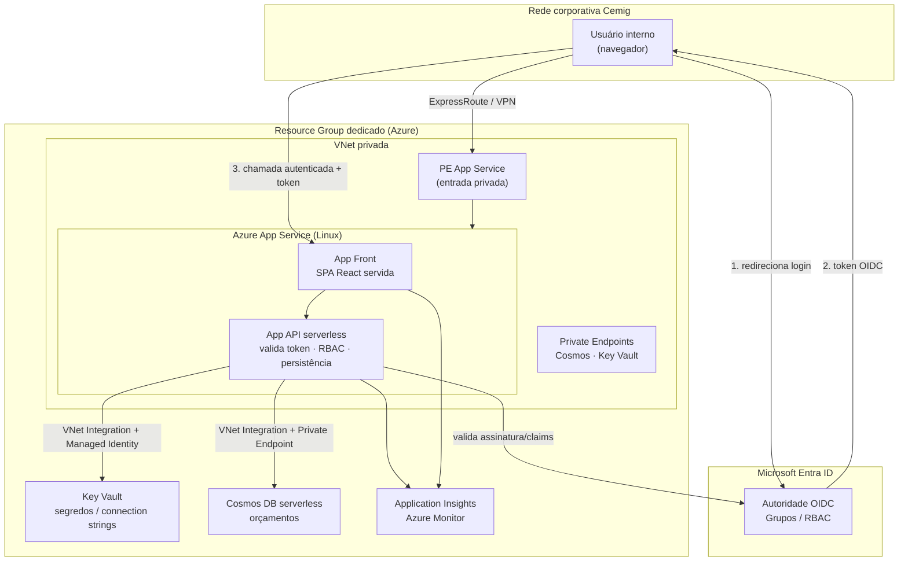
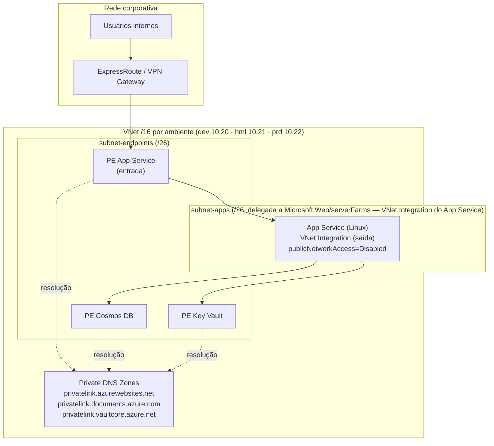
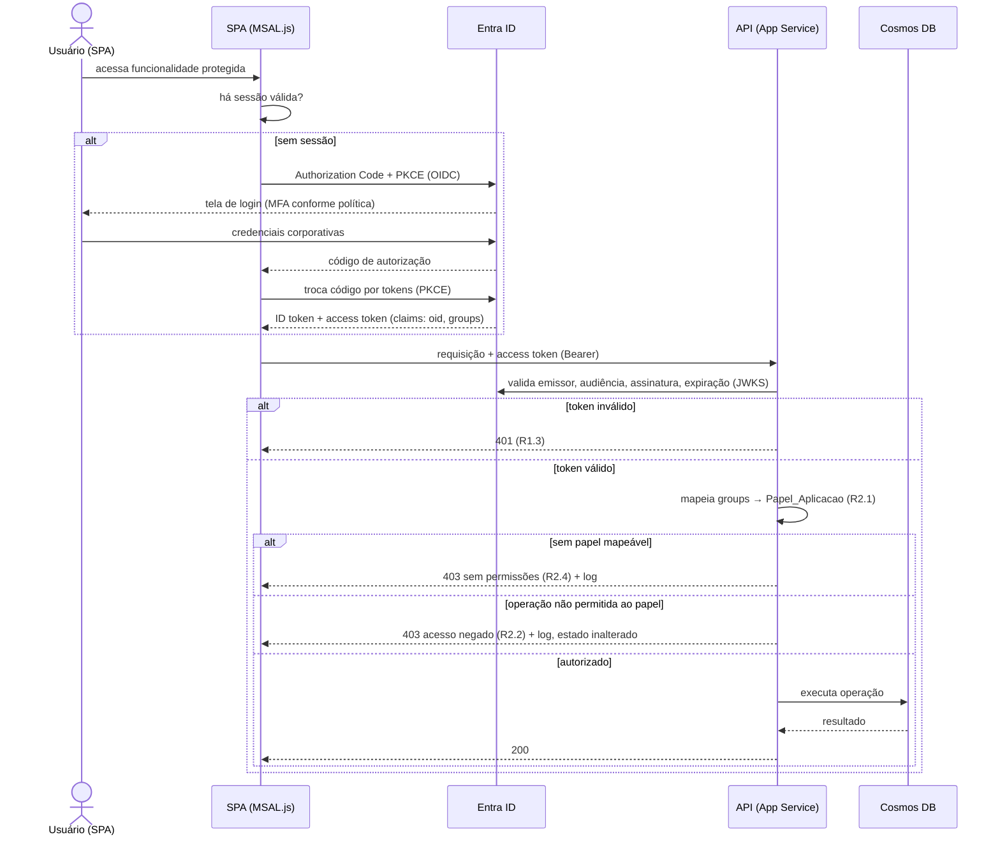
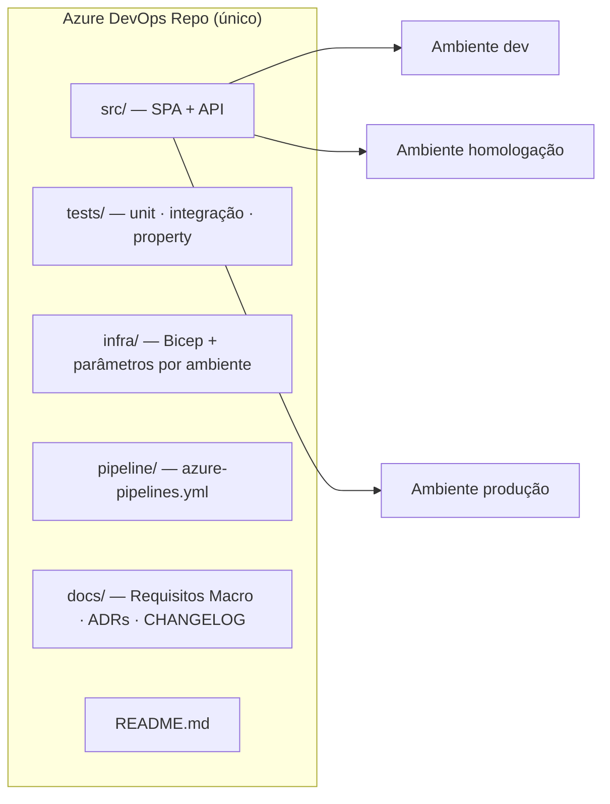
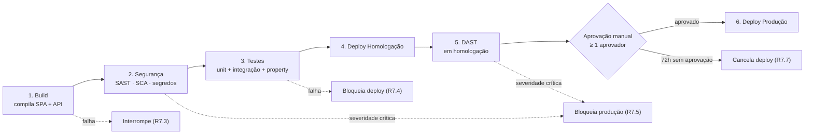

# Design Document

## Overview

Este documento descreve o **design técnico da alteração do Sistema_Orcamento_MT** para adequá-lo às diretrizes corporativas da Cemig. O foco é a transformação arquitetural da solução — não o preenchimento dos documentos da pasta `diretrizes/`, tratado apenas como artefato documental de apoio (R14).

### Ponto de partida

Hoje o Sistema_Orcamento_MT é uma SPA React 18 + Vite + Tailwind, 100% client-side, sem back-end, com persistência em `localStorage`, publicada no GitHub Pages via GitHub Actions. A lógica de negócio (cálculos CT/PP/ERD/PFC, memorial, consolidação PROORC) já é composta de funções JavaScript puras (`src/utils/calculos.js`, `src/proorc/*`), o que é um ativo importante: essa lógica pode ser preservada integralmente na migração.

### Estado-alvo (resumo das decisões)

| Dimensão | Hoje | Alvo | Requisitos |
| --- | --- | --- | --- |
| Hospedagem | GitHub Pages | Azure, serverless first, Resource Group dedicado | R3 |
| Rede | Internet pública | Rede interna corporativa, sem exposição pública | R4 |
| Identidade | Nenhuma | Microsoft Entra ID (OIDC + PKCE), RBAC por grupos | R1, R2 |
| Camada de serviço | Nenhuma (só front) | API serverless para validar token e persistir dados | R1, R2, R5 |
| Persistência | `localStorage` | Armazenamento gerenciado Azure + `localStorage` como cache | R5 |
| IaC | Nenhuma | Bicep, state remoto, parametrizado dev/hml/prd | R6 |
| CI/CD | GitHub Actions | Azure DevOps Pipelines com gates de segurança | R7 |
| Repositório | GitHub | Azure DevOps Repos com proteção de branch | R8 |
| Segredos | — | Azure Key Vault + Managed Identity | R9 |
| Observabilidade | `console.error` | Application Insights / Azure Monitor + mascaramento | R10 |
| LGPD | Não tratado | Classificação, segregação, anonimização, direitos do titular | R11 |
| Versionamento | `package.json` | SemVer + tags + CHANGELOG automatizados | R12 |
| Responsividade | Parcial | Validada em celular/tablet/desktop | R13 |

### Decisão-chave: introdução de uma camada de back-end

A combinação de **autenticação Entra ID com validação de token no servidor** (R1.2), **autorização RBAC server-side** (R2) e **rede privada sem IP público** (R4) torna inviável manter a aplicação 100% client-side. Uma SPA pura não pode validar assinatura de token de forma confiável nem aplicar negação por padrão de operações — essas garantias precisam residir em um componente que o usuário não controla. Portanto, o design introduz uma **API serverless** entre a SPA e os dados. Essa é a mudança estrutural central da adequação.

## Architecture

### Decisão de plataforma de hospedagem

Avaliamos as opções serverless da Azure contra o requisito de **acesso exclusivamente interno** (R4):

| Opção | Serverless | Suporta ingress privado (sem IP público) | Veredito |
| --- | --- | --- | --- |
| Azure Static Web Apps | Sim | Limitado — o endpoint gerenciado é público; private endpoint tem restrições e o plano requerido encarece a solução | Descartado para o front |
| **App Service (plano Linux) + Private Endpoint** | **Parcial (PaaS, escala gerenciada)** | **Sim, com Private Endpoint (`publicNetworkAccess = Disabled`) para entrada e VNet Integration para saída** | **Escolhido** |
| Azure Container Apps em ambiente com VNet interna | Sim | Sim — ambiente "internal", ingress só com IP privado na VNet | Descartado — exige subnet /23, acima do limite corporativo de /25 por subnet |
| Azure Functions (Premium/Flex) em VNet | Sim | Sim (private endpoint) | Alternativa viável para a API |

**Decisão:** servir a SPA e a API por **Azure App Service (Linux)**, com:

- **entrada privada:** `publicNetworkAccess = Disabled` + **Private Endpoint** (groupId `sites`) na `subnet-endpoints`, sem IP público (R4.1, R4.4);
- **saída:** **VNet Integration** por uma subnet dedicada e delegada a `Microsoft.Web/serverFarms`, por onde a aplicação alcança os Private Endpoints de Cosmos DB e Key Vault;
- `httpsOnly = true` e `minTlsVersion = 1.2` (R4.2, R4.3).

O App Service é PaaS com escala gerenciada, atendendo o "serverless first" (R3.2) de forma pragmática dado o constraint de rede, e dispensa camada de borda pública (WAF/CDN), que o escopo expressamente não exige.

> Trade-off registrado (R3.3): o fator decisivo é a restrição corporativa de rede. A equipe de Redes cria as subnets **manualmente** (não via IaC), com limite de **no máximo /25 por subnet**. O ambiente interno do Azure Container Apps exige uma subnet **/23**, incompatível com esse limite, o que descarta a opção. O App Service integra-se à VNet por uma subnet dedicada delegada a `Microsoft.Web/serverFarms` que cabe em **/26** (recomendação da Microsoft), respeitando o limite de /25. Static Web Apps seria o caminho mais simples para uma SPA, mas sua limitação de rede privada o torna incompatível com R4. Caso a Arquitetura prefira Functions puras para a API, a topologia permanece válida (Functions em plano com integração de VNet + private endpoint); a decisão final e eventual exceção serão registradas no Documento_Requisitos_Macro.

### Componentes da solução



### Topologia de rede privada (R4)



**Regras de rede aplicadas:**

- App Service com `publicNetworkAccess = Disabled`: a **entrada** ocorre exclusivamente por **Private Endpoint** (groupId `sites`, resolvido pela zona `privatelink.azurewebsites.net`) na `subnet-endpoints`; não há FQDN público roteável (R4.1, R4.4).
- Saída do App Service por **VNet Integration** na `subnet-apps` (/26) dedicada e delegada a `Microsoft.Web/serverFarms`, por onde a aplicação alcança os Private Endpoints internos.
- Acesso dos usuários exclusivamente pela rede corporativa via ExpressRoute/VPN já existentes (R4.6). Requisições originadas da internet pública não têm rota para o Private Endpoint — conexão sem resposta.
- Cosmos DB e Key Vault com `publicNetworkAccess = Disabled` e acesso somente por **Private Endpoint** na `subnet-endpoints`, resolvidos por **Private DNS Zones** (R4.5).
- `httpsOnly = true` e TLS 1.2+ (`minTlsVersion = 1.2`) obrigatórios no App Service; conexões em protocolo inferior são recusadas antes de atingir a aplicação (R4.2, R4.3). Certificado gerenciado.

### Fluxo de autenticação e autorização (R1, R2)



**Pontos de design:**

- **Front (SPA):** biblioteca MSAL.js com fluxo *Authorization Code + PKCE* (R1.1). Nenhuma validação de segurança é confiada ao front; ele apenas obtém e anexa o token.
- **Back (API):** valida o token em toda requisição contra as chaves públicas (JWKS) do tenant — emissor, audiência, assinatura, expiração (R1.2, R1.3). Timeout de 30 s no fluxo de autenticação devolve falha com nova tentativa (R1.7).
- **Sessão:** expiração por inatividade ≥ 30 min encerra a sessão (R1.4). Nenhum cadastro/senha próprios (R1.5).
- **RBAC:** o claim `groups` do token é mapeado para `Papel_Aplicacao` por uma tabela de configuração (grupo → papel). A sessão recebe a união das permissões (R2.1). **Negação por padrão** (R2.3): toda rota exige um papel explicitamente autorizado; na ausência de papel, acesso negado (R2.4). Usuário autenticado mas não autorizado à aplicação recebe recusa (R1.6).

### Estrutura de repositório e ambientes (R8, R11.2)



Três ambientes isolados (dev/hml/prd), sem compartilhamento de credenciais, bases ou armazenamento (R11.2), provisionados pelo mesmo IaC parametrizado (R6.2). Branch `main` protegida: PR obrigatório, pipeline aprovado e ao menos 1 revisão (R8.3–R8.5). README com objetivo, arquitetura, execução local e implantação (R8.6).

### Migração do repositório para o Azure DevOps (R8.7, R8.8)

A adequação começa pela **migração do código do `Repositorio_GitHub` para o `Repositorio_Destino`** no Azure DevOps (projeto "Orcamento MT", organização "cemig"), em `https://dev.azure.com/cemig/Orcamento%20MT`, **preservando o histórico de commits completo**. Essa é a primeira etapa da transição porque todo o restante — IaC, pipeline, versionamento, publicação na Azure — passa a ser versionado e entregue a partir do destino único.

```mermaid
flowchart LR
    GH["Repositorio_GitHub<br/>(origem atual)"] -->|git clone --mirror| MIR["Cópia espelho local<br/>branches + tags + histórico"]
    MIR -->|varredura de segredos<br/>no histórico (R9.4)| SCAN{"Segredos no<br/>histórico?"}
    SCAN -->|sim| CLEAN["Limpeza / reescrita<br/>de histórico"]
    CLEAN --> MIR
    SCAN -->|não| PUSH["git push --mirror"]
    PUSH --> ADO["Repositorio_Destino<br/>Azure DevOps"]
    ADO -->|validação + cutover| ORIG["Origem única do código<br/>GitHub congelado/arquivado"]
```

**Estratégia técnica de migração:**

1. **Espelhamento preservando histórico (R8.7):** `git clone --mirror` do `Repositorio_GitHub` e, após validação, `git push --mirror` para o `Repositorio_Destino`. O modo *mirror* transfere **todas as branches, tags e o histórico de commits original** sem reescrita, satisfazendo a exigência de preservação do histórico.
2. **Varredura de segredos no histórico (R9.4):** antes de considerar o destino definitivo, executar varredura de segredos sobre **todo o histórico** da cópia espelho (não apenas o `HEAD`). Caso algum segredo em texto claro seja encontrado em commits antigos, é necessário **limpeza/reescrita do histórico** (ex.: remoção dos segredos e reescrita dos commits afetados) e rotação dos segredos expostos antes do *push* definitivo — o histórico só é considerado íntegro quando a varredura não aponta ocorrências.
3. **Corte (cutover) e origem única (R8.8):** após validar o conteúdo migrado (histórico, branches, tags) no destino, o `Repositorio_Destino` passa a ser a **origem única** do código. O `Repositorio_GitHub` é **congelado/arquivado** (tornado *read-only* ou arquivado) para impedir desenvolvimento paralelo, e os `remotes` locais da equipe são reapontados para o Azure DevOps.
4. **Configuração pós-migração no destino:** aplicar a **branch policy** da `main` (PR obrigatório, pipeline verde e ao menos 1 revisão — R8.3–R8.5), garantir a **estrutura de pastas** `src`/`tests`/`infra`/`pipeline`/`docs` (R8.2) e habilitar o **Pipeline_CICD do Azure DevOps**, que substitui o fluxo do GitHub Actions (R7.1).
5. **Fim do GitHub Pages (R3.5):** com a origem única no Azure DevOps e a entrega pelo pipeline corporativo, a **publicação passa a ocorrer na Azure** (App Service), encerrando a publicação no GitHub Pages — não há mais referência ao GitHub Pages como ambiente de deploy.

> A migração do repositório é pré-requisito das demais etapas de transição (ver seção "Transição"): só depois de estabelecida a origem única é que IaC, pipeline, armazenamento gerenciado e publicação na Azure passam a operar a partir dela.

### Pipeline CI/CD (R7)



Cada estágio só inicia após sucesso do anterior (R7.2). Gates: falha de build/teste interrompe (R7.3, R7.4); vulnerabilidade de Severidade_Critica em SAST/SCA/DAST bloqueia produção (R7.5); deploy em produção exige aprovação manual registrada (R7.6) que expira em 72 h (R7.7). O pipeline substitui o fluxo do GitHub Actions (R7.1).

## Components and Interfaces

### Front-end (SPA React)

Mantém React 18 + Vite + Tailwind e **toda a lógica de cálculo e componentes de UI existentes**. Mudanças:

- Adiciona camada de autenticação (MSAL.js) e *guards* de rota.
- Substitui o acesso direto a `localStorage` por um **cliente de persistência** que fala com a API, mantendo `localStorage` como cache local/offline (ver R5).
- Garante responsividade validada (R13).

### API serverless

Contrato REST mínimo, todas as rotas autenticadas e autorizadas por papel:

| Método | Rota | Papel mínimo | Descrição | Requisitos |
| --- | --- | --- | --- | --- |
| GET | `/api/health` | — | Health check (sem dados) | R10 |
| GET | `/api/orcamentos` | leitor | Lista orçamentos do usuário/escopo | R2 |
| GET | `/api/orcamentos/{id}` | leitor | Recupera um orçamento | R5 |
| PUT | `/api/orcamentos/{id}` | editor | Cria/atualiza orçamento (gravação atômica) | R5.4 |
| DELETE | `/api/orcamentos/{id}` | editor | Remove orçamento | R2 |
| POST | `/api/titular/solicitacoes` | editor | Registra solicitação de direito do titular (LGPD) | R11.4 |

Responsabilidades da API: validação de token (R1), RBAC (R2), persistência atômica (R5.4), recuperação de segredos via Managed Identity + Key Vault (R9.2), emissão de logs/métricas estruturados com mascaramento (R10).

### Interfaces de infraestrutura

| Componente | Interface | Observação |
| --- | --- | --- |
| App Service (Linux) | Entrada por Private Endpoint; saída por VNet Integration | `publicNetworkAccess=Disabled`, `httpsOnly`, TLS 1.2+ |
| Cosmos DB | SDK via Private Endpoint | `publicNetworkAccess=Disabled` |
| Key Vault | SDK via Managed Identity + Private Endpoint | Sem segredos em código |
| Application Insights | SDK de telemetria | Logs estruturados JSON |

## Data Models

### Modelo de orçamento persistido

O orçamento hoje é um objeto único serializado em `localStorage` (ver `useOrcamento.js`). O modelo gerenciado preserva esse formato e adiciona metadados de controle corporativo. Documento no Cosmos DB (chave de partição por ambiente/escopo):

```json
{
  "id": "uuid-do-orcamento",
  "ambiente": "prd",
  "versaoSchema": 3,
  "proprietarioOid": "<object id do Entra ID>",
  "classificacao": "interno",
  "criadoEm": "2025-01-01T12:00:00Z",
  "atualizadoEm": "2025-01-01T12:34:56Z",
  "dados": {
    "cliente": "...", "ns": "...", "tipoAtendimento": "...",
    "itensObra": [ { "categoria": "ctc", "valor": 0, "percentualCemig": 0 } ],
    "erd": 0, "musd": 0, "totalObra": 0,
    "ctcTotal": 0, "ppTotal": 0, "parcelaRegTotal": 0,
    "pfcCliente": 0, "valorTotal": 0,
    "dataBase": "AAAA-MM-DD", "dataValidade": "AAAA-MM-DD"
  }
}
```

- `versaoSchema` reaproveita a migração já existente (`src/utils/migracao.js`) para compatibilidade de dados antigos.
- `proprietarioOid` registra o identificador do Entra ID (nunca dado pessoal direto) — base para direitos do titular (R11.4) e auditoria (R10.1).
- `classificacao` suporta a classificação da informação (R11.1).
- Partição por `ambiente` garante segregação lógica; o isolamento forte vem de **contas/recursos distintos por ambiente** (R5.3, R11.2).

### Modelo de solicitação de direito do titular (LGPD)

```json
{
  "id": "uuid",
  "titularRef": "<referência não reidentificável>",
  "tipo": "acesso | correcao | exclusao | portabilidade",
  "status": "registrada | atendida | recusada",
  "motivoRecusa": null,
  "registradaEm": "2025-01-01T00:00:00Z",
  "prazoLimite": "2025-01-16T00:00:00Z"
}
```

Atendimento em até 15 dias corridos (R11.4); recusa registra motivo e preserva o dado (R11.5).

### Modelo de mapeamento grupo → papel (RBAC)

Configuração versionada (parâmetro de IaC / Key Vault), não dado de usuário:

```json
{
  "mapeamentos": [
    { "grupoEntraId": "<guid-grupo-leitores>", "papel": "leitor" },
    { "grupoEntraId": "<guid-grupo-editores>", "papel": "editor" },
    { "grupoEntraId": "<guid-grupo-admins>", "papel": "admin" }
  ],
  "permissoesPorPapel": {
    "leitor": ["orcamentos:ler"],
    "editor": ["orcamentos:ler", "orcamentos:gravar", "titular:registrar"],
    "admin": ["orcamentos:ler", "orcamentos:gravar", "orcamentos:remover", "titular:registrar"]
  }
}
```

### Decisão de persistência (R5)

**Opção recomendada: (b) complementar o `localStorage` com armazenamento gerenciado na Azure (Cosmos DB serverless).**

| Opção | Prós | Contras |
| --- | --- | --- |
| (a) só `localStorage` | Zero mudança de dados | Não atende controles corporativos; dado preso ao navegador; sem backup/auditoria |
| **(b) `localStorage` + Azure (recomendada)** | Mantém trabalho offline/rascunho; dado corporativo com criptografia, segregação e auditoria; migração incremental | Exige sincronização e resolução de conflito |
| (c) substituir por Azure | Modelo mais limpo | Perde edição offline; migração mais abrupta; maior risco na transição |

Justificativa: a opção (b) preserva a experiência atual (rascunho local, resiliência a oscilação de rede) e satisfaz os controles corporativos para o dado persistido como fonte da verdade — criptografia em repouso ≥ AES-256 (R5.2, nativa do Cosmos DB), segregação por ambiente (R5.3), gravação atômica com preservação do estado anterior em falha (R5.4) e conclusão em ≤ 5 s em rede corporativa (R5.5). Cosmos DB serverless escala a zero e cobra por consumo, aderente ao serverless first (R3.2). A decisão final é registrada no Documento_Requisitos_Macro (R5.1).

## Correctness Properties

*Uma propriedade é uma característica ou comportamento que deve se manter verdadeiro em todas as execuções válidas do sistema — essencialmente, uma afirmação formal sobre o que o sistema deve fazer. Propriedades servem de ponte entre especificações legíveis por humanos e garantias de corretude verificáveis por máquina.*

Nem todos os requisitos desta adequação são adequados a teste baseado em propriedades. Rede, IaC, pipeline, repositório e renderização de UI são configuração/infraestrutura e serão cobertos por testes de integração, snapshot e checagens de política (ver Testing Strategy). As propriedades abaixo cobrem a **lógica do nosso código** com comportamento universal: validação de token, autorização, atomicidade e preservação dos dados/cálculos na migração, mascaramento e versionamento.

### Property 1: Validação de token aceita apenas tokens íntegros

*Para qualquer* token de identidade, a API estabelece sessão se, e somente se, emissor, audiência, assinatura e expiração forem todos válidos; qualquer alteração em um desses campos resulta em recusa.

**Validates: Requirements 1.2, 1.3**

### Property 2: Expiração de sessão por inatividade

*Para qualquer* duração de inatividade `t`, a sessão permanece válida se `t < 30 min` e é encerrada (exigindo nova autenticação) se `t ≥ 30 min`.

**Validates: Requirements 1.4**

### Property 3: Permissões da sessão são a união dos papéis mapeados

*Para qualquer* conjunto de grupos do Entra ID e tabela de mapeamento, as permissões concedidas à sessão são exatamente a união das permissões de todos os Papel_Aplicacao mapeados a partir desses grupos.

**Validates: Requirements 2.1**

### Property 4: Negação por padrão preservando o estado

*Para qualquer* par (papel, operação) em que a operação não esteja explicitamente nas permissões do papel — incluindo o caso de sessão sem nenhum papel mapeável —, a operação é negada e o estado dos dados permanece inalterado.

**Validates: Requirements 1.6, 2.2, 2.3, 2.4**

### Property 5: Atomicidade da gravação de orçamento

*Para qualquer* estado de orçamento e qualquer ponto de falha injetado durante a gravação no armazenamento gerenciado, após a falha o estado persistido é igual ao estado anterior, sem gravação parcial.

**Validates: Requirements 5.4**

### Property 6: Preservação dos dados e cálculos na migração

*Para qualquer* orçamento válido, (a) serializar e desserializar pelo caminho de persistência gerenciada reproduz um orçamento equivalente; (b) aplicar a migração de schema é idempotente; e (c) os invariantes dos cálculos financeiros preservados pela lógica atual continuam válidos: PFC do cliente nunca negativa, o ERD coberto nunca excede o mínimo entre ERD disponível, parcela regulatória e PFC antes do ERD, e os totais derivados (material 60% / serviços 40% do total da obra) permanecem consistentes com o total da obra.

**Validates: Requirements 5.4**

### Property 7: Mascaramento de dados sensíveis em logs e segredos

*Para qualquer* entrada de log contendo dado pessoal e *para qualquer* valor de segredo recuperado do Cofre_Segredos, o conteúdo efetivamente gravado em log ou retornado em mensagem de erro nunca contém o valor original de forma recuperável.

**Validates: Requirements 9.3, 10.4**

### Property 8: Estrutura obrigatória do log

*Para qualquer* evento operacional registrado, o log estruturado emitido contém carimbo de tempo em UTC, nível de severidade válido (DEBUG, INFO, WARN, ERROR), identificador de correlação e identificador do componente de origem.

**Validates: Requirements 10.1**

### Property 9: Anonimização impede reidentificação

*Para qualquer* Dado_Pessoal originado de produção, a função de anonimização aplicada antes do uso em desenvolvimento ou homologação produz uma saída da qual o titular não é reidentificável (não contém o identificador original nem permite recompô-lo).

**Validates: Requirements 11.3**

### Property 10: Round-trip e incremento de versão semântica

*Para qualquer* versão semântica válida `MAJOR.MINOR.PATCH` (cada componente inteiro de 0 a 999999), analisar e reformatar reproduz a mesma versão, e cada tipo de incremento (MAJOR/MINOR/PATCH) aplica exatamente a regra correspondente respeitando os limites.

**Validates: Requirements 12.1**

## Error Handling

| Cenário | Comportamento | Requisitos |
| --- | --- | --- |
| Token inválido/expirado | API responde 401; sessão não estabelecida | R1.3 |
| Timeout de 30 s no fluxo de autenticação | Recusa com indicação de falha e opção de nova tentativa | R1.7 |
| Usuário autenticado sem autorização | 403 com indicação de acesso não autorizado; sem sessão | R1.6 |
| Sessão sem papel mapeável | 403 "sem permissões"; registra evento (oid, data/hora) | R2.4 |
| Operação não permitida ao papel | 403 "acesso negado"; estado inalterado; registra (oid, operação, data/hora) | R2.2 |
| Falha de gravação no armazenamento | Preserva estado anterior (sem gravação parcial); indica erro ao usuário | R5.4 |
| Falha ao recuperar segredo do Key Vault | Aborta operação dependente; loga sem expor o valor; retorna erro de indisponibilidade | R9.3 |
| Falha ao emitir log/métrica | Registra a falha localmente e continua a operação em curso | R10.5 |
| Falha de execução do IaC | Preserva o último state remoto válido (sem state parcial); registra a causa | R6.5 |
| Build/testes reprovados no pipeline | Interrompe; impede estágios seguintes; registra status de falha | R7.3, R7.4 |
| Vulnerabilidade crítica (SAST/SCA/DAST) | Bloqueia deploy em produção; registra bloqueio por severidade | R7.5 |
| Aprovação de produção não concedida em 72 h | Cancela o deploy; registra expiração | R7.7 |
| Tag de versão já existente | Preserva a tag; retorna erro de conflito | R12.3 |
| Falha ao atualizar CHANGELOG | Preserva conteúdo anterior; retorna erro | R12.5 |
| Requisição externa / TLS < 1.2 | Conexão recusada sem encaminhar aos componentes internos | R4.3, R4.6 |
| Direito do titular não atendível | Registra motivo; preserva o Dado_Pessoal | R11.5 |

**Princípios transversais:**

- **Nunca expor dados sensíveis em erro:** mensagens de erro e logs passam pelo mascaramento (R9.3, R10.4) — Propriedade 7.
- **Preservação de estado em falha:** gravações, migrações, IaC e CHANGELOG preservam o estado anterior em caso de falha (R5.4, R6.5, R12.5) — Propriedade 5.
- **Degradação graciosa de telemetria:** falha de observabilidade não interrompe a operação de negócio (R10.5).

## Testing Strategy

### Abordagem dupla

- **Testes unitários:** exemplos específicos, casos de borda e condições de erro.
- **Testes de propriedade:** propriedades universais sobre a lógica do nosso código (seção Correctness Properties).
- **Testes de integração / snapshot / política:** para infraestrutura, rede, pipeline, repositório e UI, onde PBT não se aplica.

### Onde PBT se aplica e onde não se aplica

PBT **se aplica** à lógica pura e às garantias de corretude do nosso código: validação de token, autorização/RBAC, atomicidade e preservação dos dados e cálculos na migração, mascaramento, estrutura de log, anonimização e versionamento semântico (Propriedades 1–10).

PBT **não se aplica** a:

- **Rede e infraestrutura (R3, R4, R6):** configuração declarativa — usar snapshot do Bicep (`az deployment ... what-if` / build) e checagens de política (ingress interno, `publicNetworkAccess=Disabled`, TLS mínimo, Resource Group único, state remoto parametrizado) e testes de integração de rede (recusa de acesso externo, TLS < 1.2).
- **Pipeline CI/CD (R7):** orquestração da ferramenta — validar a definição (ordem de estágios, gates, aprovação, expiração) e executar o pipeline em cenários controlados (build falho, teste falho, segredo semeado, vulnerabilidade crítica simulada).
- **Repositório (R8):** checagens de existência de pastas (`src/tests/infra/pipeline/docs`), presença das seções do README e configuração de branch policy.
- **UI responsiva (R13):** testes de layout em breakpoints (≤480 px, 481–1024 px, >1024 px), snapshot/regressão visual e validação manual em três resoluções.
- **Documentos (R14, R3.3, R5.1, R11.1):** checagens de presença/não-vazio de seções e de substituição dos campos "(preencher)".

### Configuração dos testes de propriedade

- Biblioteca: **fast-check** (ecossistema JS/TS do projeto; não implementar PBT do zero).
- Mínimo de **100 iterações** por teste de propriedade.
- Cada teste referencia a propriedade do design com a tag:
  **Feature: adequacao-diretrizes-cemig, Property {número}: {texto da propriedade}**
- Cada uma das 10 propriedades é implementada por **um** teste de propriedade. Dependências externas (JWKS, Key Vault, Cosmos DB) são substituídas por mocks para manter custo baixo e foco na lógica.

### Preservação dos cálculos (destaque da migração)

A Propriedade 6 é o seguro da adequação: os cálculos CT/PP/MUSD/ERD/PFC/rateio (`src/utils/calculos.js`) e a migração de schema (`src/utils/migracao.js`) já são puros. Os testes de propriedade geram orçamentos aleatórios, exercitam o round-trip de serialização e os invariantes financeiros (PFC ≥ 0; ERD coberto ≤ min(disponível, parcela regulatória, PFC antes do ERD); consistência material/serviços), garantindo que a introdução da API e do armazenamento gerenciado **não altere nenhum resultado financeiro**.

### Testes de integração essenciais

- Autenticação ponta a ponta (SPA ↔ Entra ID ↔ API) com 1–2 exemplos (R1.1, R1.7).
- Recuperação de segredo via Managed Identity + Key Vault (R9.2).
- Latência de gravação ≤ 5 s em rede corporativa, medindo p95 (R5.5).
- Emissão de métricas e disparo de alerta em ≤ 60 s (R10.2, R10.3).
- Isolamento entre ambientes dev/hml/prd (R5.3, R11.2).

## Transição

A adequação segue uma sequência de transição em que **a migração do repositório é o primeiro passo**, pois tudo o mais passa a ser versionado e entregue a partir da origem única:

1. **Repositório (R8.7, R8.8):** migrar o `Repositorio_GitHub` para o `Repositorio_Destino` no Azure DevOps preservando o histórico (`git clone --mirror` → varredura de segredos no histórico → `git push --mirror`), fazer o *cutover* para origem única e congelar/arquivar o GitHub. Ver "Migração do repositório para o Azure DevOps".
2. **Infraestrutura e pipeline:** a partir do destino, provisionar os recursos por IaC parametrizado (R6) e ativar o Pipeline_CICD do Azure DevOps, substituindo o GitHub Actions (R7.1).
3. **Publicação (R3.5):** encerrar o GitHub Pages; a aplicação passa a ser publicada na Azure (App Service, via *zip deploy* do código Node).
4. **Persistência (R5):** evoluir de `localStorage` para `localStorage` + Cosmos DB serverless, com migração incremental de dados (ver "Decisão de persistência").

## Documento de Requisitos Macro (artefato)

Será produzido como artefato em `docs/requisitos-macro.md` (R14.1), contendo seções identificáveis e não vazias: objetivo, escopo, público usuário, dados tratados, integrações, requisitos não funcionais e critérios de aceite. Também registrará decisões referenciadas pelo design: destino da persistência (R5.1), eventuais divergências do padrão serverless e suas aprovações (R3.3) e a classificação/base legal/finalidade/retenção dos dados (R11.1). O preenchimento dos campos "(preencher)" dos documentos da pasta `diretrizes/` (R14.2, R14.3) é tarefa operacional de apoio, derivada deste documento, e não é foco do design.
