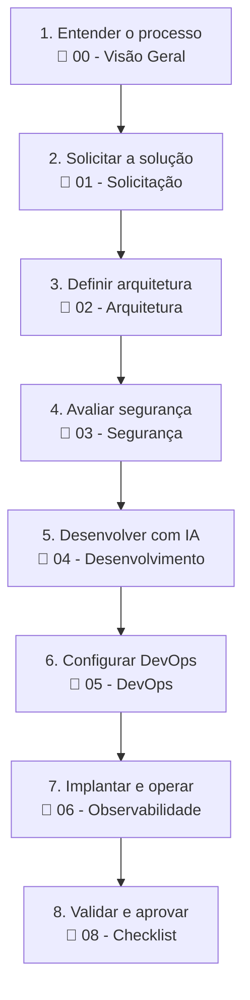
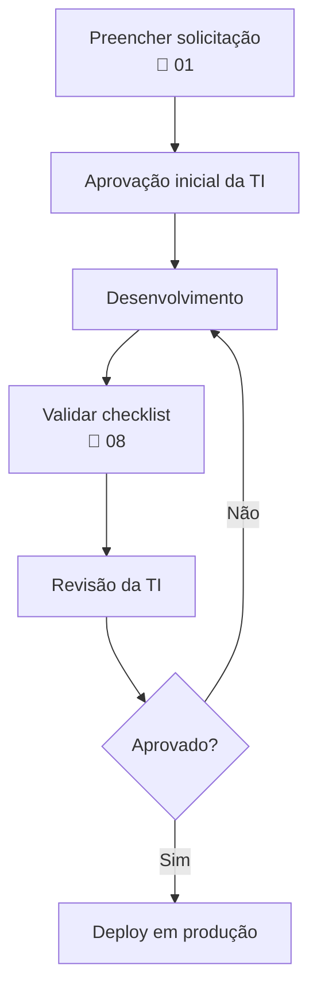

# 00 — Visão Geral

> **Framework para Desenvolvimento de Soluções com IA**
> **Versão:** 1.0 · **Data:** 24/08/2026

---

## Objetivo

Este conjunto de documentos estabelece os padrões para concepção, desenvolvimento, implantação e operação de soluções corporativas utilizando Inteligência Artificial e desenvolvimento assistido por IA.

---

## Público-alvo

| Perfil | Descrição |
| --- | --- |
| Áreas de negócio | Demandantes de soluções |
| Desenvolvedores | Profissionais técnicos que implementam |
| Desenvolvedores cidadãos | Profissionais não técnicos usando IDEs agênticas |
| Arquitetos de solução | Responsáveis por decisões técnicas |
| Equipes de segurança | Revisão e aprovação de segurança |
| Equipes de sustentação | Operação e monitoramento |

---

## Escopo

Este framework cobre:

- Soluções desenvolvidas com apoio de IDEs agênticas (Kiro, GitHub Copilot, etc.)
- Aplicações em nuvem (AWS, GCP, Azure)
- Agentes de IA corporativos
- Integrações com sistemas legados e de terceiros
- Requisitos de segurança, LGPD e governança

---

## Jornada recomendada

---

## Documentos do framework

| # | Documento | Objetivo |
| --- | --- | --- |
| 00 | [Visão Geral](00-visao-geral.md) | Introdução e navegação |
| 01 | [Solicitação de Solução](01-solicitacao-de-solucao.md) | Formulário e onboarding |
| 02 | [Arquitetura de Referência](02-arquitetura-de-referencia.md) | Padrões arquiteturais |
| 03 | [Segurança e Compliance](03-seguranca-e-compliance.md) | Segurança, LGPD e identidade |
| 04 | [Desenvolvimento Assistido por IA](04-desenvolvimento-assistido-por-ia.md) | Uso de Kiro, Copilot e outras IDEs |
| 05 | [DevOps e Governança](05-devops-e-governanca.md) | Repositórios, pipelines e deploy |
| 06 | [Observabilidade](06-observabilidade.md) | Logs, métricas e monitoramento |
| 07 | [Catálogo de Arquiteturas](07-catalogo-de-arquiteturas.md) | Exemplos e templates |
| 08 | [Checklist de Aprovação](08-checklist-de-aprovacao.md) | Critérios de entrada em produção |
| 09 | [Agentes de IA Corporativos](09-agentes-de-ia-corporativos.md) | Padrões para agentes, RAG e MCP |

---

## Quais documentos devo ler?

### Profissional da área de negócio

- 00 — Visão Geral
- 01 — Solicitação de Solução
- 08 — Checklist de Aprovação

### Profissional desenvolvedor

- 00 — Visão Geral
- 02 — Arquitetura de Referência
- 03 — Segurança e Compliance
- 04 — Desenvolvimento Assistido por IA
- 05 — DevOps e Governança
- 08 — Checklist de Aprovação

### Criação de um agente de IA

- 00 — Visão Geral
- 02 — Arquitetura de Referência
- 03 — Segurança e Compliance
- 04 — Desenvolvimento Assistido por IA
- 05 — DevOps e Governança
- 06 — Observabilidade
- 09 — Agentes de IA Corporativos

---

## Princípios fundamentais

1. **Serverless first** — exceções justificadas e aprovadas pela Arquitetura.
2. **Entra ID** — identidade corporativa única, independente da nuvem.
3. **Rede privada sempre que possível** — acessos externos com proteção (WAF, API Gateway).
4. **LGPD e proteção de dados** — classificação, base legal e retenção definidos desde o início.
5. **Observabilidade** — logs, métricas e alertas como padrão.
6. **Infraestrutura como código** — nada provisionado manualmente.
7. **Revisão humana** — IA é ferramenta, não decisor final.

---

## Fluxo de aprovação

---

## Contato e suporte

| Assunto | Canal |
| --- | --- |
| Dúvidas técnicas gerais | *(pendente — a validar com a TI)* |
| Ferramentas de IA (Kiro, Copilot) | *(pendente — a validar com a TI)* |
| Arquitetura e aprovações | *(pendente — a validar com a Arquitetura/TI)* |
| Segurança e compliance | *(pendente — a validar com a equipe de segurança)* |
| LGPD e proteção de dados | *(pendente — a validar com o DPO/encarregado de dados)* |

---

**Próxima revisão programada:** *(pendente — a validar: DD/MM/AAAA)*
