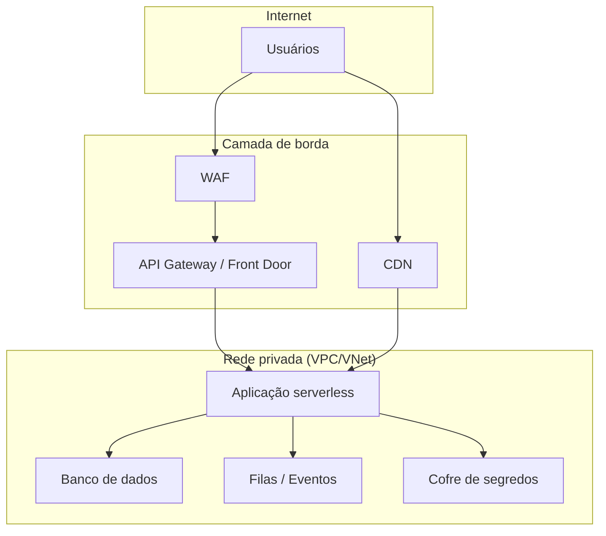

# 02 — Arquitetura de Referência

> Padrões arquiteturais obrigatórios e recomendados para soluções corporativas.

---

## 1. Princípio fundamental: Serverless First

A arquitetura *serverless* deve ser a abordagem preferencial para todas as soluções corporativas.

**Exceções** devem ser justificadas e aprovadas pela Arquitetura. Exemplos de exceções válidas:

- Workloads de IA que exigem GPU dedicada
- Aplicações legadas em processo de migração
- Soluções de terceiros que exigem infraestrutura específica
- Migrações temporárias (com prazo definido para adequação)
- SAP e sistemas que não oferecem alternativa serverless

### 1.1 Exceção para setores com infraestrutura própria

Setores que possuem datacenter próprio (como **COD** ou **COS**) podem optar por hospedar a solução em sua própria infraestrutura, sem obrigatoriedade de arquitetura serverless em nuvem pública. Nesse caso:

- A decisão deve ser registrada no formulário de solicitação com justificativa.
- **Todas as demais diretrizes do framework continuam obrigatórias** (segurança, Entra ID, LGPD, observabilidade, pipeline CI/CD, repositório corporativo).
- O setor deve adotar e incentivar **práticas modernas e seguras de desenvolvimento**:
  - Contêinerização de aplicações (Docker/Kubernetes).
  - Automação de deploy (CI/CD).
  - Segregação de ambientes (dev/homologação/produção).
  - Infraestrutura como código (sempre que viável).
  - Monitoramento e alertas operacionais.
- A Arquitetura pode solicitar revisão periódica para avaliar migração futura para serverless em nuvem.

---

## 2. Nuvens homologadas

| Nuvem | Status |
| --- | --- |
| AWS | Homologada |
| Google Cloud (GCP) | Homologada |
| Microsoft Azure | Homologada |

### Critérios para escolha

| Critério | Perguntas a responder |
| --- | --- |
| Custo | Qual nuvem oferece o melhor custo total (execuções, armazenamento, tráfego)? |
| Integração | Onde estão os sistemas que preciso integrar? |
| Funcionalidades | Os serviços necessários existem na nuvem? |
| Competência interna | A TI já opera essa nuvem? |
| Compliance | Atende requisitos de residência de dados? |

> A justificativa deve ser registrada no formulário (doc 01) e no README.md do repositório.

---

## 3. Frameworks de referência

| Nuvem | Framework |
| --- | --- |
| Azure | [Cloud Adoption Framework (CAF)](https://learn.microsoft.com/azure/cloud-adoption-framework/) e [Well-Architected Framework](https://learn.microsoft.com/azure/well-architected/) |
| AWS | [Well-Architected Framework](https://aws.amazon.com/architecture/well-architected/) |
| GCP | [Architecture Framework](https://cloud.google.com/architecture/framework) |

---

## 4. Componentes serverless por nuvem

### Computação

| Finalidade | AWS | Azure | GCP |
| --- | --- | --- | --- |
| Funções | Lambda | Azure Functions | Cloud Functions |
| Contêineres serverless | Fargate | Container Apps | Cloud Run |
| Orquestração | Step Functions | Durable Functions / Logic Apps | Workflows |

### Armazenamento e banco de dados

| Finalidade | AWS | Azure | GCP |
| --- | --- | --- | --- |
| Objeto | S3 | Blob Storage | Cloud Storage |
| NoSQL | DynamoDB | Cosmos DB | Firestore |
| SQL serverless | Aurora Serverless | SQL Database Serverless | Cloud SQL (Serverless não disponível nativamente) |

### Mensageria e eventos

| Finalidade | AWS | Azure | GCP |
| --- | --- | --- | --- |
| Filas | SQS | Service Bus | Pub/Sub |
| Eventos | EventBridge | Event Grid | Eventarc |
| Streaming | Kinesis | Event Hubs | Dataflow |

### API e entrada

| Finalidade | AWS | Azure | GCP |
| --- | --- | --- | --- |
| API Gateway | API Gateway | API Management | Cloud Endpoints / Apigee |
| CDN | CloudFront | Front Door / CDN | Cloud CDN |
| WAF | AWS WAF + Shield | Front Door WAF / App Gateway WAF | Cloud Armor |

---

## 5. Rede privada por padrão

Todos os componentes devem utilizar rede privada (VPC/VNet) **sempre que possível**.

### Arquitetura de rede

### Regras de rede

| Regra | Descrição |
| --- | --- |
| Componentes internos | Sem IP público, sem acesso direto da internet |
| Comunicação entre serviços | Via endpoints privados (Private Link, VPC Endpoint) |
| Acesso externo | Exclusivamente via camada de borda com WAF |
| Integração com on-premise | VPN ou Direct Connect / ExpressRoute / Cloud Interconnect |

---

## 6. Integrações

### APIs

- Sempre autenticadas (OAuth 2.0 / mTLS)
- Tráfego em rede privada sempre que possível (Private Link / VPC Endpoint)
- Tratamento de erros com retry e backoff exponencial
- Rate limiting e circuit breaker

### Eventos e mensageria

- Preferir comunicação assíncrona para operações não críticas em tempo real
- Dead letter queue para mensagens com falha
- Idempotência nos consumidores

### Integração entre nuvens

- Federação de identidade (OIDC) em vez de chaves estáticas
- Minimizar tráfego cross-cloud (custo e latência)
- Documentar justificativa de integração multi-cloud

---

## 7. Infraestrutura como código

| Requisito | Descrição |
| --- | --- |
| **Obrigatório** | Todo recurso provisionado por código versionado |
| Ferramentas aceitas | Terraform, Bicep, CDK, Pulumi, CloudFormation, SAM |
| Proibido | Provisionamento manual pelo console |
| Ambientes | Código parametrizado para dev, homologação e produção |
| Estado | State remoto e protegido (S3 + DynamoDB, Azure Storage, GCS) |

---

## 8. Design responsivo

- Toda interface voltada a usuários finais deve funcionar em celular, tablet e desktop.
- Priorizar frameworks que suportem responsividade nativamente.
- Testar em pelo menos 3 resoluções antes de submeter à aprovação.

---

> Próximo documento: [03 — Segurança e Compliance](03-seguranca-e-compliance.md)
