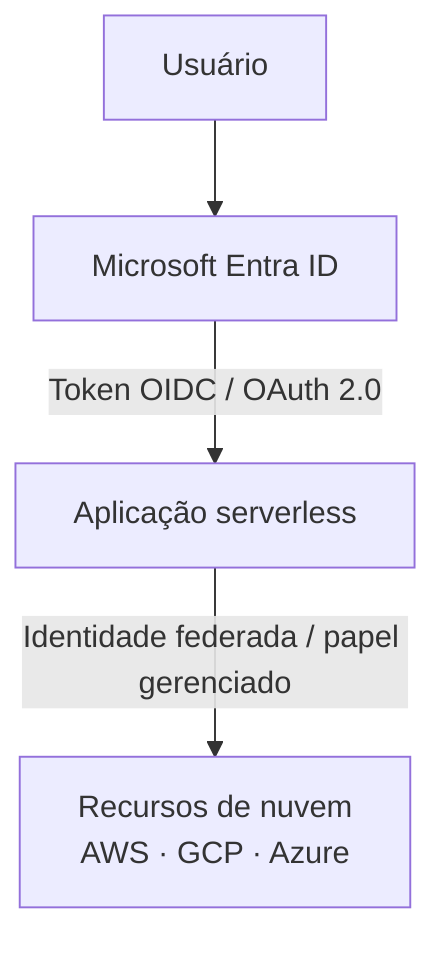

# 03 — Segurança e Compliance

> Requisitos de segurança, LGPD, identidade e proteção de dados.

---

## 1. Autenticação e autorização

### 1.1 Identidade corporativa: Microsoft Entra ID

- **Obrigatório:** todas as soluções corporativas devem utilizar o **Microsoft Entra ID** como provedor de identidade, independentemente da nuvem escolhida.
- **Obrigatório:** autorização baseada em grupos e papéis do Entra ID (RBAC).
- **Obrigatório:** federação de identidade quando a aplicação rodar em AWS ou GCP (OIDC federado, sem chaves de acesso estáticas).
- **Proibido:** cadastro e senha próprios da aplicação, ou qualquer mecanismo de autenticação paralelo.

### 1.2 Fluxo de autenticação

### 1.3 Configurações obrigatórias

- OAuth 2.0 com OpenID Connect e PKCE para front-end
- Registro da aplicação no Entra ID com escopos mínimos
- Validação de token no back-end (emissor, audiência, expiração, assinatura)
- Mapeamento de grupos do Entra ID para papéis da aplicação
- Renovação de sessão e expiração por inatividade
- MFA habilitado conforme política corporativa

---

## 2. Segurança no pipeline

| Requisito | Descrição | Quando aplicar |
| --- | --- | --- |
| SAST | Análise estática de código | Obrigatório em todo PR e commit na main |
| SCA | Análise de dependências de terceiros | Obrigatório no pipeline |
| DAST | Teste dinâmico de segurança | Obrigatório antes de produção |
| Varredura de segredos | Detecção de credenciais no código | Obrigatório no pipeline |

### Regras não negociáveis

- Falhas de severidade **alta** ou **crítica** bloqueiam deploy em produção.
- Nenhuma credencial, token, chave ou connection string no código ou em variáveis de pipeline em texto claro.
- Dependências com vulnerabilidades conhecidas de severidade crítica devem ser atualizadas antes do deploy.

---

## 3. Rede e exposição

### 3.1 Rede privada como padrão

- Componentes devem utilizar rede privada (VPC/VNet) **sempre que possível**.
- Comunicação entre serviços via endpoints privados.
- Sem IP público em bancos de dados, filas ou serviços internos.

### 3.2 Proteção para acessos externos

Quando necessário acesso externo, os seguintes recursos são **obrigatórios**:

| Camada | Recurso | Exemplos |
| --- | --- | --- |
| Borda | WAF | AWS WAF, Azure Front Door WAF, Cloud Armor |
| Gateway | API Gateway com throttling | API Gateway, API Management, Apigee |
| DDoS | Proteção volumétrica | AWS Shield, Azure DDoS Protection, Cloud Armor |
| TLS | Certificado gerenciado (TLS 1.2+) | ACM, App Service Certificates, Certificate Manager |
| CDN | Cache e distribuição | CloudFront, Azure CDN/Front Door, Cloud CDN |

---

## 4. Criptografia

| Tipo | Requisito |
| --- | --- |
| Em trânsito | TLS 1.2+ obrigatório em todas as comunicações |
| Em repouso | AES-256 ou equivalente em todos os dados armazenados |
| Chaves | Gerenciadas pelo serviço de KMS da nuvem (CMK quando aplicável) |
| Cofre de segredos | Key Vault (Azure), Secrets Manager (AWS), Secret Manager (GCP) |

---

## 5. LGPD e proteção de dados

### 5.1 Classificação da informação

| Classificação | Descrição | Controles mínimos |
| --- | --- | --- |
| **Público** | Informação disponível ao público | Integridade |
| **Interno** | Uso corporativo | Controle de acesso por autenticação |
| **Confidencial** | Sensível ao negócio | Criptografia, controle por perfil, auditoria |
| **Restrito** | Altíssimo impacto | Criptografia forte, acesso nominal, auditoria detalhada, segregação |

### 5.2 Requisitos LGPD

Quando a solução tratar dados pessoais:

| Requisito | Descrição |
| --- | --- |
| **Identificação** | Mapear quais dados pessoais são coletados, armazenados e processados |
| **Base legal** | Definir e registrar a base legal para cada tratamento |
| **Finalidade** | Documentar a finalidade específica |
| **Minimização** | Coletar apenas dados estritamente necessários |
| **Retenção** | Definir prazo de retenção e procedimento de descarte/anonimização |
| **Direitos do titular** | Mecanismo para atender direitos (acesso, correção, exclusão, portabilidade) |
| **Compartilhamento** | Documentar com quem e sob qual base legal |
| **RIPD** | Relatório de impacto quando houver dados sensíveis ou larga escala |

### 5.3 Controles técnicos

| Controle | Aplicação |
| --- | --- |
| Segregação de ambientes | Dev, homologação e produção isolados |
| Anonimização em não-produção | Dados pessoais nunca copiados para dev/homologação sem anonimizar |
| Mascaramento em logs | Dados pessoais nunca em logs ou mensagens de erro |
| Backup com retenção | Política definida e automatizada |
| Descarte seguro | Processo automatizado ao fim do prazo de retenção |

---

## 6. Gestão de segredos

| Regra | Descrição |
| --- | --- |
| Armazenamento | Exclusivamente em cofre gerenciado |
| Rotação | Automática, com período máximo definido |
| Acesso | Apenas identidades que precisam, com auditoria |
| Código | Nenhuma credencial, token ou chave no código-fonte |
| Variáveis de pipeline | Marcadas como *secret*, nunca em texto claro |

---

## 7. Menor privilégio

- Identidades (usuários, serviços, funções) recebem apenas as permissões necessárias.
- Políticas revisadas periodicamente.
- Service accounts/roles com escopo mínimo por recurso.
- Acesso administrativo restrito e auditado.

---

## 8. Auditoria

| Requisito | Descrição |
| --- | --- |
| Ações sensíveis | Login, alteração de dados, acessos administrativos registrados |
| Trilha de auditoria | Imutável e com retenção mínima de 1 ano |
| Acesso à auditoria | Restrito a equipes de segurança e compliance |
| Alertas | Anomalias de acesso geram alerta automático |

---

> Próximo documento: [04 — Desenvolvimento Assistido por IA](04-desenvolvimento-assistido-por-ia.md)
