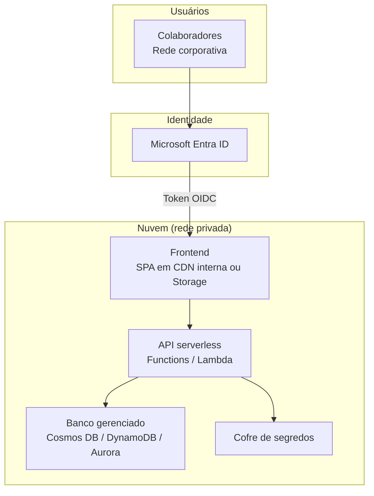
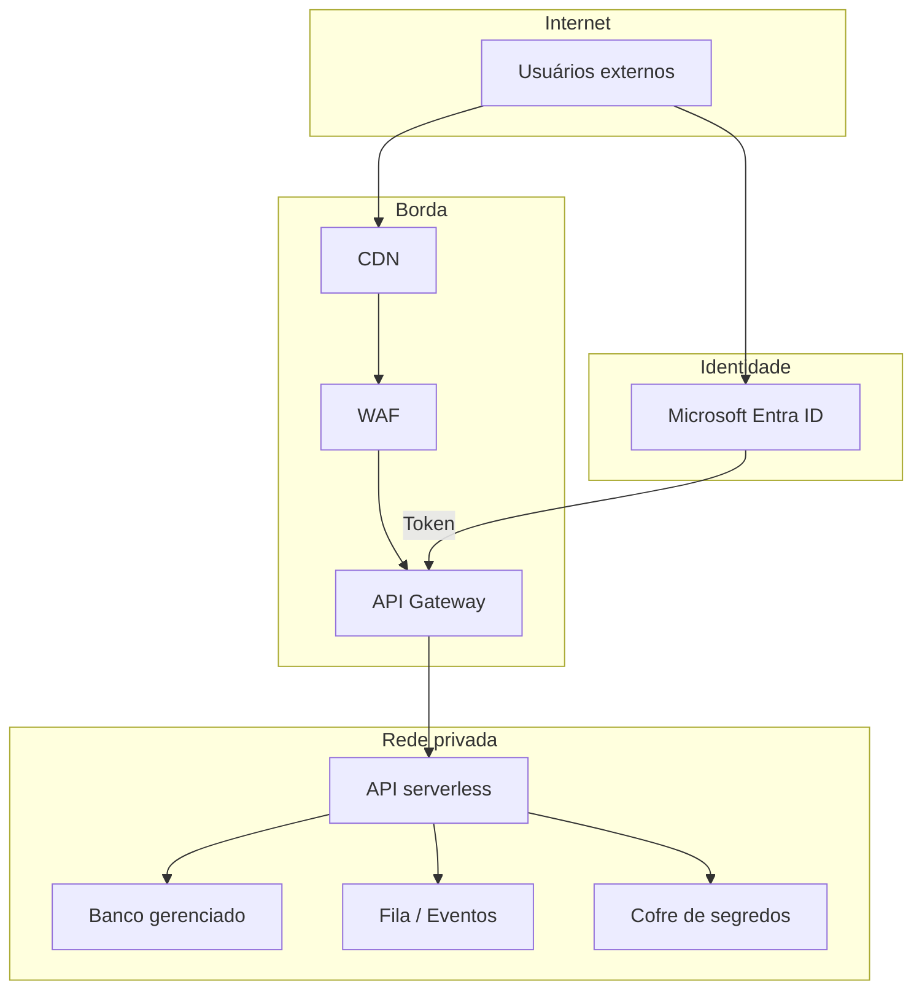
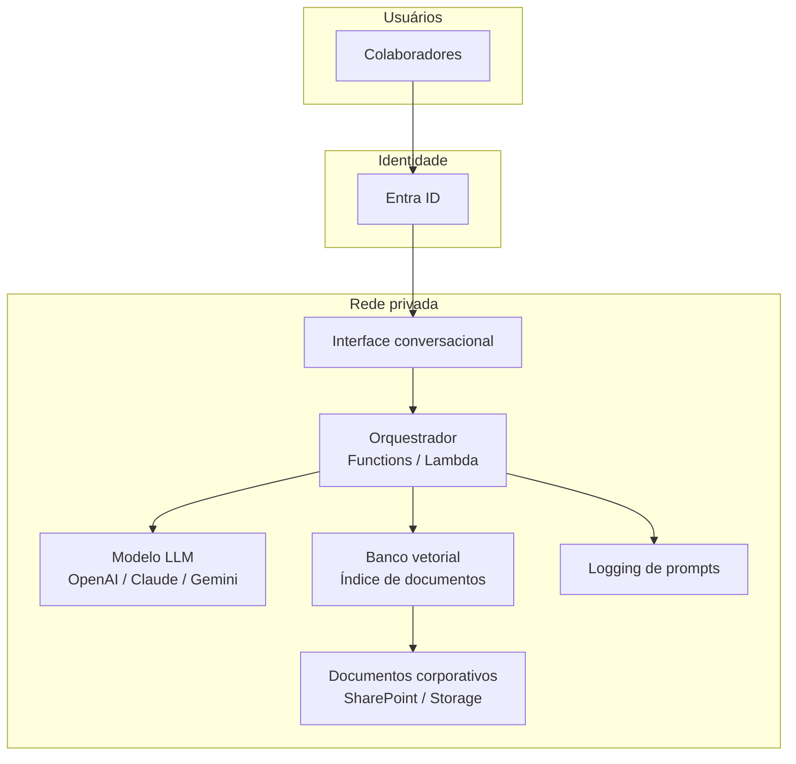
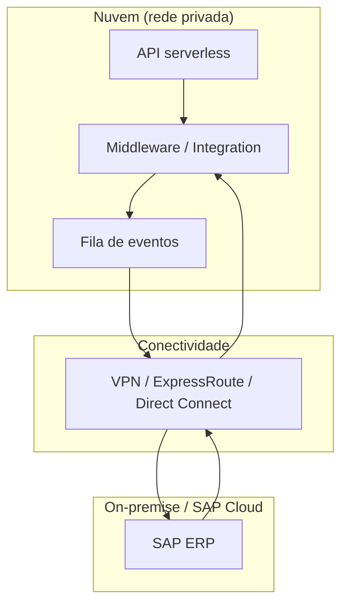
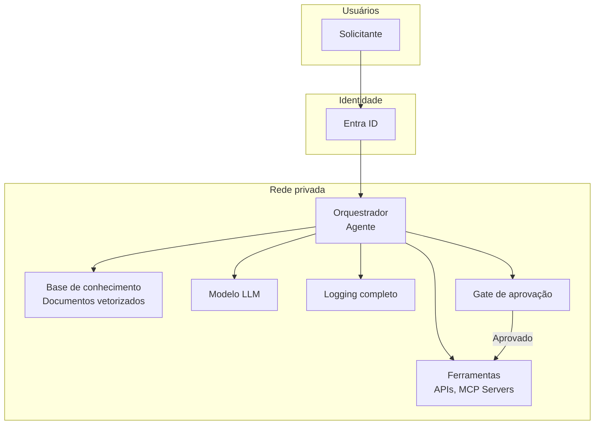
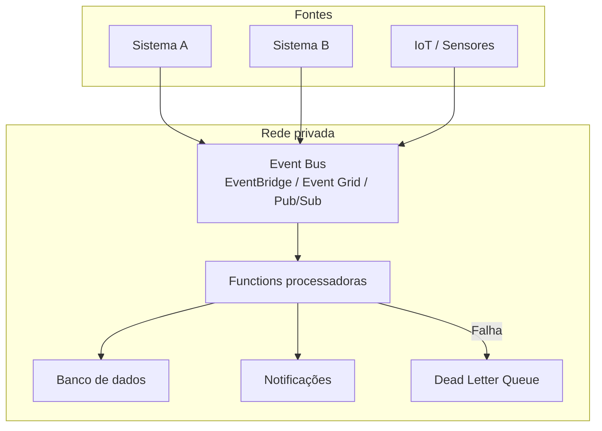

# 07 — Catálogo de Arquiteturas

> Exemplos prontos de arquiteturas de referência para cenários comuns.

---

## 1. Aplicação Web Interna

### Cenário
Aplicação web para uso interno (intranet), sem acesso externo.

### Componentes

### Stack por nuvem

| Componente | AWS | Azure | GCP |
| --- | --- | --- | --- |
| Frontend | S3 + CloudFront (interno) | Blob Storage + Private Endpoint | Cloud Storage |
| API | Lambda + API Gateway (privado) | Azure Functions + VNet Integration | Cloud Functions + VPC Connector |
| Banco | Aurora Serverless / DynamoDB | Cosmos DB / SQL Serverless | Firestore / Cloud SQL |
| Segredos | Secrets Manager | Key Vault | Secret Manager |

---

## 2. Aplicação Web com Acesso Externo

### Cenário
Aplicação acessível via internet (portal de clientes, B2B).

### Componentes

### Proteções obrigatórias

- WAF com regras OWASP
- Rate limiting no API Gateway
- DDoS protection ativo
- TLS 1.2+ em todas as conexões
- Certificado gerenciado

---

## 3. Chatbot com IA

### Cenário
Assistente conversacional usando LLM com acesso a documentos corporativos (RAG).

### Componentes

### Requisitos específicos

- Não enviar dados pessoais ao LLM sem avaliação de impacto
- Logging de todos os prompts e respostas (auditoria)
- Indicação clara ao usuário de que está interagindo com IA
- Fontes das respostas referenciadas (grounding)
- Monitoramento de alucinações

---

## 4. Integração SAP

### Cenário
Integração com SAP on-premise ou cloud.

### Componentes

### Requisitos específicos

- Conectividade privada (VPN, ExpressRoute, Direct Connect)
- Autenticação mTLS ou OAuth entre sistemas
- Tratamento de erros com retry e dead letter queue
- Mapeamento de dados e transformação no middleware
- Monitoramento de latência e disponibilidade da integração

---

## 5. Agente de IA Corporativo

### Cenário
Agente autônomo que executa tarefas com aprovação humana.

### Componentes

### Requisitos específicos

- Níveis de autonomia definidos (ver doc 09)
- Logging de prompts, contexto e ações executadas
- Gate de aprovação humana para ações destrutivas
- Fontes de dados controladas e aprovadas
- Monitoramento de custos de uso do LLM

---

## 6. Processamento de eventos (Event-Driven)

### Cenário
Sistema reativo a eventos de negócio.

### Componentes

### Requisitos específicos

- Idempotência nos consumidores
- Dead letter queue para falhas
- Retry com backoff exponencial
- Ordenação quando necessário (FIFO)
- Monitoramento de profundidade de fila

---

## Como usar este catálogo

1. Identifique o cenário mais próximo da sua solução.
2. Use o diagrama como ponto de partida para a IDE agêntica.
3. Adapte os componentes conforme a nuvem escolhida.
4. Valide com a Arquitetura antes de iniciar o desenvolvimento.
5. Documente desvios em relação ao padrão.

---

> Próximo documento: [08 — Checklist de Aprovação](08-checklist-de-aprovacao.md)
